### 8.1 buck＆boost＆buckboost拓扑与开关电源的原理

#### 8.1.1 为什么需要开关电源

- 在前面几章我们已经知道，想要得到一个稳定的电压，最"直观"的两种做法是[电阻分压]和[线性稳压]（LDO，见 8.2 节），但它们都有一个共同的致命缺点——**只能把多余的电压"烧掉"**。
- **电阻分压**：用一个上电阻和一个下电阻把 12V 分出 5V，多出来的 7V 全部变成热消耗在电阻上。这样做的效率最高只有 $\frac{5}{12}\approx 42\%$，而且负载（相当于并联在下电阻上的一个电阻）一变，输出电压就跟着变，根本稳不住。
- **线性稳压（LDO）**：它确实能稳压，但本质仍然是"把多余的能量烧掉"，效率约等于 $\frac{V_o}{V_{in}}$。12V 降到 5V，效率最高也只有约 42%，剩下 58% 的功率全都变成了调整管上的热。
- 这两种做法在电流很小时都还能用，但一旦负载要 3A，12V 降到 5V 时被扔掉的功率就是 $(12-5)\ \mathrm{V}\times 3\ \mathrm{A}=21\ \mathrm{W}$，一颗普通芯片瞬间就会被烧毁。
- 既然"烧掉"不行，那**能不能把能量"搬"到输出端去，而不是扔掉？**当然可以，这就是本章的主角——**开关电源**：先用储能元件（电感、电容）把能量存起来，再以另一个电压放出去，中间几乎不产生损耗。
- 这一节我们先复习储能元件，再一步步推出 buck／boost／buck-boost 三种最基础的拓扑。

#### 8.1.2 储能元件与伏秒平衡

- 复习第 2 章的两个基本公式：

  $$i=C\frac{du}{dt}\qquad u=L\frac{di}{dt}$$

  第一个式子说"电容的电压不能突变"，第二个式子说"电感的电流不能突变"。这两条"不能突变"，正是开关电源能够工作的物理基础。
- **电感把能量储存在磁场里**，储能大小是 $W=\frac{1}{2}LI^2$；**电容把能量储存在电场里**，储能大小是 $W=\frac{1}{2}CU^2$。
- 电感储存磁能的能力有上限：一旦电流超过[饱和电流 $I_{sat}$]，磁芯饱和，感值急剧下降（详见第 2.3 节）。设计开关电源时如果电感饱和，整个电路会瞬间失效。
- **伏秒积与伏秒平衡**：
  - 把 $u=L\frac{di}{dt}$ 两边对时间积分，得到 $\Delta I=\frac{1}{L}\int u\,dt$。其中积分 $\int u\,dt$ 的单位是"伏·秒"，我们把它叫做[伏秒积]，它正比于电感电流的变化量。
  - 在稳定的周期性工作状态下，电感电流在一个周期结束时必须回到周期开始时的值（否则每周期都变化就不叫"稳定"了），所以**一个完整开关周期内，电感两端伏秒积之和必须为零**，即"正伏秒 = 负伏秒"。这就是[伏秒平衡]。
  - 伏秒平衡是分析一切开关电源拓扑最核心的工具，后面的 buck／boost／buck-boost 全都靠它推导。
- **开关**：开关电源里必然有一个管子（三极管或 MOS 管，见第 3 章）反复导通、关断。理想情况下，导通时它相当于一根导线（无压降），关断时相当于断路（无电流），所以开关本身不消耗能量——这就是它效率远高于线性稳压的原因。
- 用 $D$ 表示[占空比]，即开关导通时间 $T_{on}$ 占整个开关周期 $T$ 的比例：

  $$D=\frac{T_{on}}{T},\qquad 0\le D\le 1$$

  开关频率 $f_{sw}=\frac{1}{T}$，周期 $T=\frac{1}{f_{sw}}$。

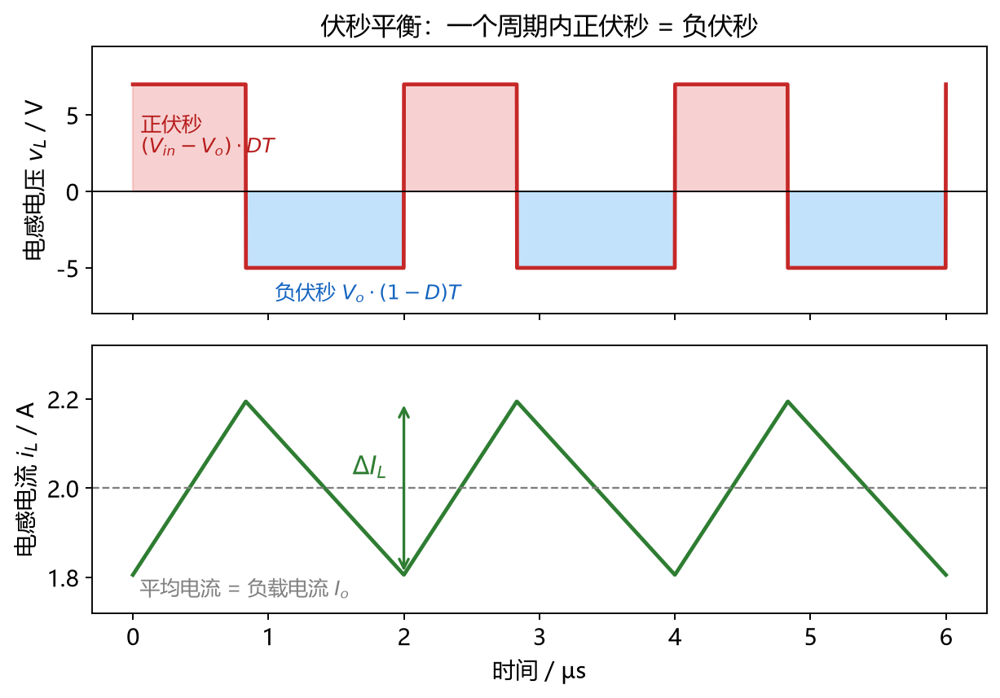

#### 8.1.3 buck（降压）拓扑

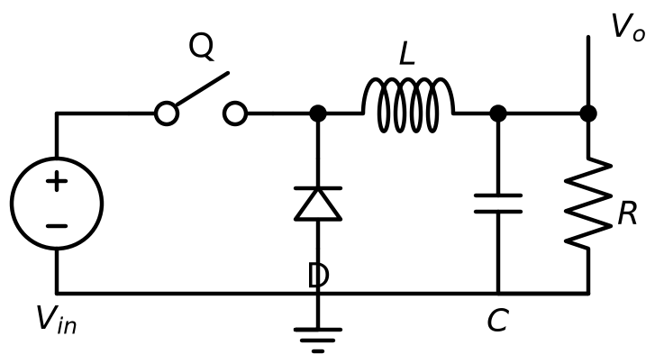

- buck 是最常用的一种，用来把较高的电压降为较低的电压。它的结构如图 8-1-3-1：一个开关管 Q、一个[续流二极管] D、一个电感 L、一个输出电容 C，负载接在输出电容两端（图中把负载画成了电阻 R）。
- 开关管的一端接输入 $V_{in}$，另一端（这个点叫做[开关节点]，在芯片手册里常写成 SW 或 PH）同时接电感的一端和二极管的一端；电感的另一端接输出 $V_o$，二极管的另一端接地。
- **开关导通阶段**（持续 $D T$ 时间）：开关管导通，输入经过开关管给电感充电，开关节点被拉到 $V_{in}$，二极管因反偏而截止。此时电感左端是 $V_{in}$、右端是 $V_o$，电感上的压降是 $V_{in}-V_o$（正伏秒），电感电流上升：

  $$\frac{di_L}{dt}=\frac{V_{in}-V_o}{L}$$

- **开关关断阶段**（持续 $(1-D)T$ 时间）：开关管断开，但电感电流不能突变，它会保持原方向继续流动，于是自动把二极管正偏导通，电流经过二极管续流（所以这个二极管叫[续流二极管]）。此时开关节点被二极管钳位到约 0V，电感左端是 0、右端是 $V_o$，电感上压降是 $-V_o$（负伏秒），电感电流下降：

  $$\frac{di_L}{dt}=\frac{-V_o}{L}$$

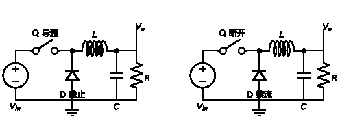

- 由伏秒平衡（正伏秒 = 负伏秒）：

  $$(V_{in}-V_o)\cdot D T=V_o\cdot(1-D)T$$

  两边消去 $T$ 并整理，得到 buck 的核心公式：

  $$V_o=D\,V_{in}$$

  也就是说，**输出电压正比于占空比**。想要 5V 输出、12V 输入，只要让占空比等于 $\frac{5}{12}\approx 41.7\%$ 即可。
- 电感电流是一个围绕负载电流平均值上下波动的[三角波]（图 8-1-3-3）：开关导通时上升，关断时下降；流过电感的平均电流就等于负载电流 $I_o$。
- 由图中的波形可以算出一个周期内电感电流的峰峰值（即[电流纹波]）：

  $$\Delta I_L=\frac{(V_{in}-V_o)D}{L f_{sw}}=\frac{V_o(1-D)}{L f_{sw}}$$

- 输出电压的纹波主要来自两部分：电感纹波电流在输出电容 ESR 上产生的压降，以及电容充放电本身。多数情况下前者占主导：

  $$\Delta V_o\approx \Delta I_L\cdot ESR \quad(\text{ESR 主导}),\qquad \Delta V_o\approx\frac{\Delta I_L}{8 f_{sw}C}\quad(\text{理想电容})$$

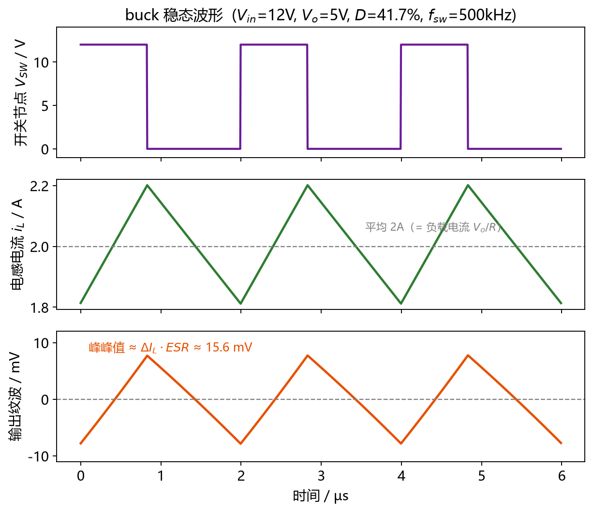

- **算例**：$V_{in}=12\ \mathrm{V}$、$V_o=5\ \mathrm{V}$、$I_o=2\ \mathrm{A}$、$f_{sw}=500\ \mathrm{kHz}$、$L=15\ \mu\mathrm{H}$、输出电容 ESR 为 $40\ \mathrm{m\Omega}$。
  - 占空比 $D=\frac{V_o}{V_{in}}=\frac{5}{12}=41.7\%$。
  - 电感纹波 $\Delta I_L=\frac{(12-5)\times 0.417}{15\times 10^{-6}\times 5\times 10^{5}}\approx 0.39\ \mathrm{A}$，约等于负载电流的 20%。
  - 由 ESR 引起的输出纹波 $\Delta V_o\approx 0.39\ \mathrm{A}\times 40\ \mathrm{m\Omega}\approx 15.6\ \mathrm{mV}$；若只看电容本身，$\frac{0.39}{8\times 5\times 10^{5}\times 220\times 10^{-6}}\approx 0.44\ \mathrm{mV}$，可以忽略。可见**输出纹波基本由 ESR 决定**，这也是为什么开关电源的输出电容特别强调[低 ESR]。
- **一个非常重要的细节**：buck 的**输入电流是脉冲的**（只有开关导通时才有电流），而电感电流（≈输出电流）是连续的。这个"输入侧脉冲电流"会在输入回路上形成一个高频、面积很大的电流环路，是 8.6 节 PCB 布局要重点处理的对象。

#### 8.1.4 boost（升压）拓扑

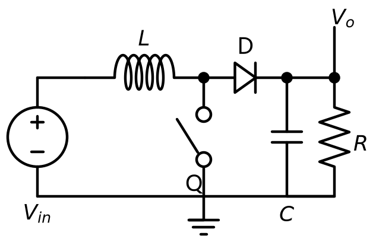

- boost 用来把较低的电压升到较高的电压。它的结构如图 8-1-4-1：输入先经过电感 L，电感另一端（开关节点）接开关管 Q 和二极管 D；二极管后面接输出电容 C 和负载。
- **开关导通阶段**（$D T$）：开关管把电感右端接到地，电感两端电压是 $V_{in}$，电感电流上升，把能量储存在磁场里；此时二极管反偏截止，输出完全靠输出电容供电。
- **开关关断阶段**（$(1-D)T$）：开关管断开，电感电流不能突变，它把开关节点电压顶高，直到二极管正偏导通，于是电感把"输入电压 + 自己储存的能量"一起送给输出。
- 由伏秒平衡：$V_{in}\cdot DT=\left(V_o-V_{in}\right)\cdot(1-D)T$，整理得

  $$V_o=\frac{V_{in}}{1-D}$$

  可见 boost 的输出电压一定高于输入，且占空比越接近 1，输出电压越高（极限情况下趋于无穷，实际中受限于损耗与元件耐压）。
- boost 的特点：**输入电流是连续的**（电感在输入端），而**输出电流是脉冲的**（二极管导通时才有电流），这正好和 buck 相反。所以 boost 的输出电容要承受很大的纹波电流，选型时对纹波电流能力要求很高。

#### 8.1.5 buck-boost（升降压）拓扑

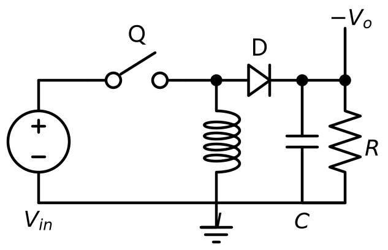

- buck-boost 既能降压也能升压，它的结构如图 8-1-5-1：输入经过开关管 Q，开关节点接一个电感 L 到地，同时接一个二极管 D 到输出；二极管的另一侧接输出电容与负载。
- **开关导通阶段**（$D T$）：开关管导通，输入电压加在电感两端，电感电流上升、储能。
- **开关关断阶段**（$(1-D)T$）：开关管断开，电感电流继续流动，把开关节点电压拉低，直到二极管正偏导通，电感把能量送给输出。
- 由伏秒平衡：$V_{in}\cdot DT=-V_o\cdot(1-D)T$，整理得

  $$V_o=-\frac{D}{1-D}V_{in}$$

  公式里的负号表示输出与输入**反相**（输出的正极是输入的地），所以这种拓扑也常被叫做[反相 buck-boost]。当 $D<0.5$ 时输出比输入低，$D>0.5$ 时输出比输入高，所以它同时具备降压和升压的能力。
- 单管 buck-boost 的缺点是输入、输出电流都是脉冲的，纹波和电磁干扰都比较大。工程上更常见的是用四个开关管搭成的[四开关 buck-boost]，它能用两个 buck 管和两个 boost 管平滑地在升降压之间切换，输入输出电流都连续，效率也更高（属于进阶内容，这里了解即可）。

#### 8.1.6 三种拓扑对比

| 拓扑 | 电压关系 | 输入电流 | 输出电流 | 典型用途 |
| --- | --- | --- | --- | --- |
| buck（降压） | $V_o=D V_{in}$ | 脉冲 | 连续 | 12V 母线降到 5V/3.3V，最常用 |
| boost（升压） | $V_o=\dfrac{V_{in}}{1-D}$ | 连续 | 脉冲 | 锂电池升到 5V、LED 恒流驱动 |
| buck-boost（升降压） | $V_o=-\dfrac{D}{1-D}V_{in}$ | 脉冲 | 脉冲 | 输入电压可能高于也可能低于输出的场合 |

- 记忆技巧：看电感接在哪一侧，**电感在输出侧的是 buck，电感在输入侧的是 boost**，两侧都有（电感跨在中间）的是 buck-boost。

#### 8.1.7 电流纹波、电感与输出电容的计算

- 上面推导出的两个公式，是工程上选电感、选电容的直接依据：

  $$\Delta I_L=\frac{V_o(1-D)}{L f_{sw}},\qquad L=\frac{V_o(1-D)}{\Delta I_L f_{sw}}$$

- 我们通常不会直接指定 $\Delta I_L$，而是用一个系数 $K_{IND}$ 来表示"电感纹波电流相对于最大输出电流的比例"，一般取 $K_{IND}=0.2\sim 0.3$，即 $\Delta I_L=K_{IND}\cdot I_{o(max)}$。$K_{IND}$ 越大，电感越小越便宜，但电流纹波、峰值电流和输出纹波都变大；$K_{IND}$ 越小则相反。
- TPS5430 数据手册给出的最小电感计算公式（式 4）为：

  $$L_{min}=\frac{V_{o(max)}\left(V_{in(max)}-V_o\right)}{V_{in(max)}\cdot K_{IND}\cdot I_o\cdot f_{sw}}$$

  手册的设计示例取 $K_{IND}=0.2$，算出最小电感约 $12.5\ \mu\mathrm{H}$，向上取标准值后选用了 $15\ \mu\mathrm{H}$。手册同时说明，配合 TPS5430 使用的电感一般落在 $10\ \mu\mathrm{H}\sim 100\ \mu\mathrm{H}$ 之间。
- 选电感时除了感值，还必须核对两个电流参数是否超标（见第 2.3 节）：**饱和电流 $I_{sat}$ 要大于电感的[峰值电流]** $I_{L(pk)}=I_o+\frac{\Delta I_L}{2}$；**温升电流 $I_{rms}$ 要大于电感电流的有效值**。手册示例选用的是 Sumida CDRH104R-150（$15\ \mu\mathrm{H}$，$I_{sat}=3.4\ \mathrm{A}$，$I_{rms}=3.6\ \mathrm{A}$），刚好覆盖计算出的峰值 3.31A 与有效值 3.003A。
- 输出电容的选取则要在"电容值"和"ESR"之间权衡：手册指出，为了配合 TPS5430 的内部补偿，闭环穿越频率宜保持在 3kHz～30kHz 之间；输出电容的**最大允许 ESR** 为

  $$ESR_{max}=\frac{1}{2\pi C_{out} f_{CO}}$$

  其中 $f_{CO}$ 是穿越频率。举个例子，若要穿越频率 18kHz、电感 15µH，则输出电容取到约 220µF，最大 ESR 约 40mΩ。选电容时要确认**实际 ESR 不超标**，并且耐压要大于输出电压加上一半的纹波电压，纹波电流能力也要留足余量。

#### 8.1.8 连续导通与断续导通（CCM／DCM）

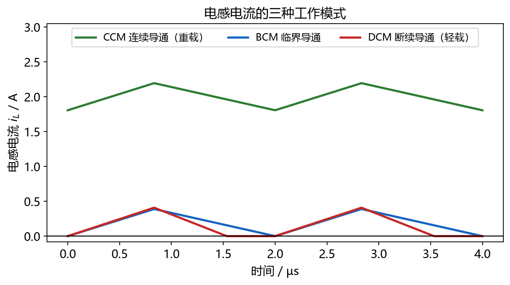

- 前面讨论的 buck 电感电流都在 0 以上（最小值大于 0），这种状态叫[连续导通模式]（CCM, Continuous Conduction Mode）。
- 如果负载电流变小，电感电流整体下移，当它的最小值刚好降到 0 时，电路处于[临界导通模式]（BCM, Boundary Conduction Mode）。
- 负载电流再小，电感电流就会出现"一段时间等于 0"的空白区，这时电路进入[断续导通模式]（DCM, Discontinuous Conduction Mode）。
- 在 DCM 下，之前推导的 $V_o=D V_{in}$ 不再成立（因为公式的前提是伏秒平衡，而 DCM 下电流归零后开关节点会出现"死区"），输出电压会比公式预期的略高，环路特性也会变化。
- TPS5430 手册就特别提到，低负载下电路会进入断续工作，这与电感纹波的取值直接相关——$K_{IND}$ 越大，进入断续的负载点越高。实际设计里，如果轻载性能很重要，就要么减小 $K_{IND}$，要么让电路在轻载时降频或跳周期工作。

#### 8.1.9 开关频率、损耗与效率

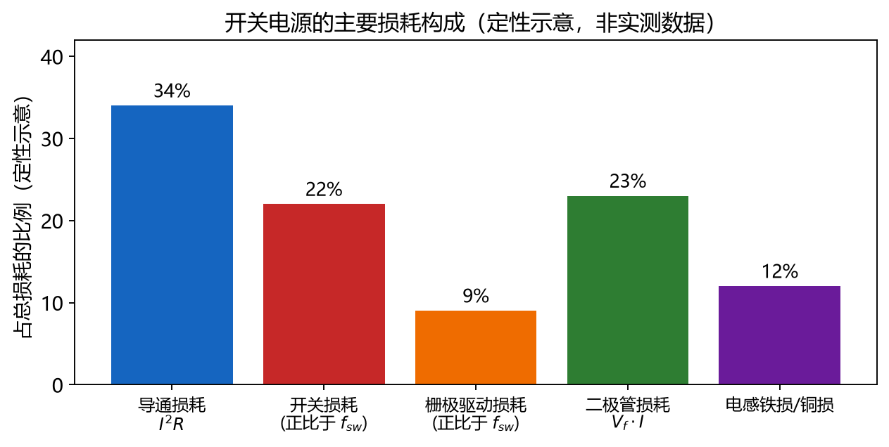

- **为什么开关频率越高越好？** 由 $\Delta I_L=\frac{V_o(1-D)}{L f_{sw}}$ 可知，$f_{sw}$ 越高，在同样纹波要求下所需的电感可以越小；输出电容的充电纹波 $\frac{\Delta I_L}{8 f_{sw}C}$ 也随 $f_{sw}$ 减小。所以提高开关频率可以让电感、电容更小、更便宜、体积更小。TPS5430 就固定工作在 500kHz，这样只需要十几微亨的电感和几百微法的电容。
- **但开关频率越高，损耗也越大**。开关电源的主要损耗有：
  - **导通损耗**：电流流过开关管、电感的寄生电阻、二极管时产生的 $I^2R$ 损耗。TPS5430 内部集成的上管导通电阻典型值为 $100\ \mathrm{m\Omega}$。
  - **开关损耗**：开关管在导通与关断的瞬间，电流和电压同时不为零，这段时间的乘积就是开关损耗，它与开关频率成正比。频率越高，每秒开关次数越多，这部分损耗越大。
  - **驱动损耗／栅极损耗**：每次开关都要给 MOS 管的栅极电容充放电，同样正比于频率。
  - **二极管损耗**：续流二极管正向导通时有固定压降 $V_f$，损耗约为 $V_f\times I_{diode}\times(1-D)$；而且二极管的导通时间通常比上管导通时间更长，所以它在总损耗里占比往往不小。
  - **电感损耗**：铜损（绕线电阻）与铁损（磁芯）。
- **同步整流**：既然二极管有 $V_f$ 损耗，能不能把它也换成一个 MOS 管？当然可以。用一个低价 MOS 管代替续流二极管，让它在续流期间导通，由于 MOS 管的导通压降远小于二极管的正向压降（$I\times R_{ds(on)}$ 可以做到几十毫伏），效率能明显提升。这种用 MOS 管代替二极管的做法叫[同步整流]，只用一个开关管 + 一个二极管的叫[非同步整流]（也叫异步整流）。MOS 管与二极管的区别详见第 3 章。
- 效率就是 $\eta=\frac{P_{out}}{P_{in}}$。TPS5430 在 12V 转 5V 时的峰值效率可达约 95%，数据手册首页给出了"效率-输出电流"曲线。
#### 8.1.10 反馈与稳压（为什么要闭环）

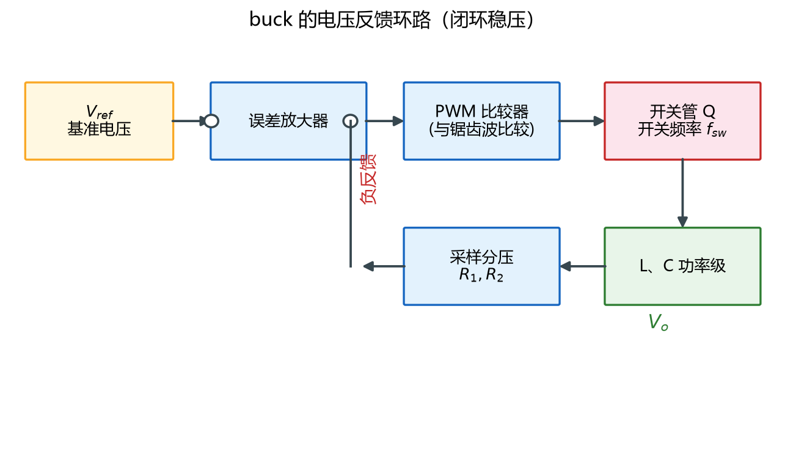

- 前面所有推导都建立在"$V_o=D V_{in}$"的理想假设上。但现实中 $V_{in}$ 会变、负载会变、元件会有损耗，如果只是给开关管一个固定的占空比，输出电压一定会飘。所以真实的开关电源必须要有[反馈]。
- 回顾第 6 章的负反馈和第 4 章的增益／相位：把输出电压分压取样（送到芯片的 VSENSE／FB 引脚），与芯片内部的[基准电压] $V_{ref}$ 相减得到误差，误差经过[误差放大器]放大，再与芯片内部的锯齿波（[斜坡发生器] Ramp）比较，比较的结果就是控制开关管通断的 PWM 信号。
- 整个环路自动完成这样的调节：输出电压偏低 → 误差为正 → 占空比增大 → 输出电压升高；输出电压偏高 → 占空比减小 → 输出电压降低。最终输出电压被稳定在

  $$V_o=V_{ref}\left(1+\frac{R_1}{R_2}\right)$$

  其中 $R_1$、$R_2$ 是反馈分压电阻，$V_{ref}$ 是芯片的基准电压。以 TPS5430 为例，它的内部基准是 $1.221\ \mathrm{V}$，所以要求 5V 输出时，$R_2=\frac{R_1\times 1.221}{V_o-1.221}$；手册建议 $R_1$ 从 $10\ \mathrm{k\Omega}$ 起步，对应 $R_2=3.24\ \mathrm{k\Omega}$。
- 环路的稳定性（增益裕度、相位裕度、补偿网络）属于进阶内容，详见第 9.4 节"简单认识电力电子"的相位与增益曲线、补偿网络部分。这里只需要建立"开关电源必须闭环才能稳压"的直觉。

### 8.2 LDO电源原理

#### 8.2.1 LDO的组成

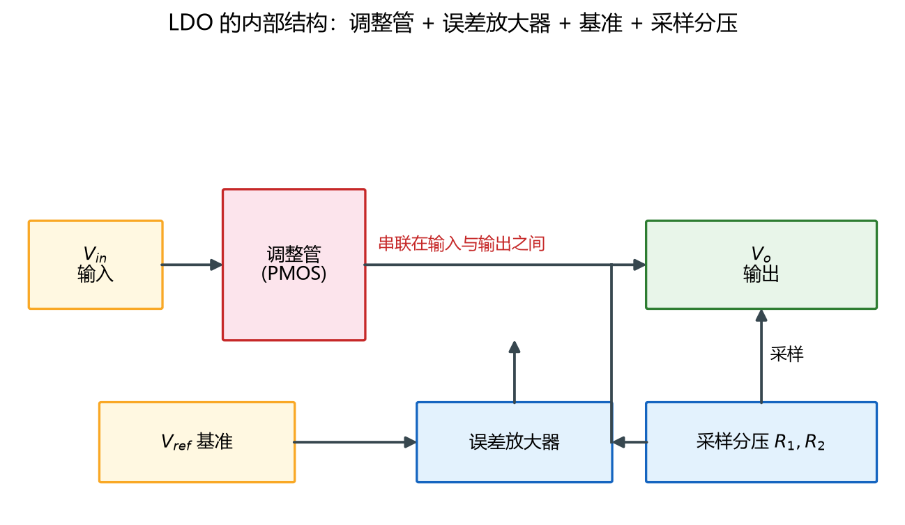

- LDO（Low Dropout Regulator，低压差线性稳压器）由四部分组成：一个作为[调整管]的晶体管、一个[误差放大器]、一个[基准电压源]，以及一对[采样分压电阻]。
- 调整管是一个[串联]在输入和输出之间的管子（负责"挡住"多余的电压），采样电阻把输出电压按比例取回来，误差放大器把采样值与基准电压比较，再驱动调整管改变它等效的阻值。

#### 8.2.2 稳压原理：负反馈

- LDO 的稳压原理就是上一节讲过的[负反馈]（见第 6 章）。
- 当输出电压偏低时，采样值低于基准，误差放大器输出增大，调整管开得更大、等效阻值变小，输入到输出的压降减小，输出电压升高；当输出电压偏高时，过程反过来。最终输出电压被稳定在 $V_o=V_{ref}\left(1+\frac{R_1}{R_2}\right)$，与 buck 的反馈分压公式完全一致。
- 与传统用三极管做调整管的线性稳压器相比，LDO 的关键区别在于它的调整管可以工作在很小的[压差]下（压差见下一节），因此效率更高。

#### 8.2.3 效率与压差

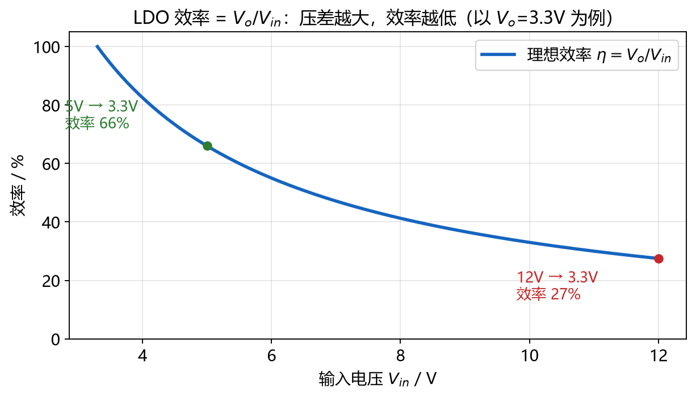

- LDO 的功率损耗等于它"吃掉"的那部分电压乘以负载电流：

  $$P_{loss}=(V_{in}-V_o)I_o$$

  所以 LDO 的效率可以写成

  $$\eta=\frac{I_o V_o}{(I_o+I_q)V_{in}}\times 100\%$$

  其中 $I_q$ 是[静态电流]（见 8.2.4）。当 $I_q$ 远小于输出电流时，效率近似为 $\frac{V_o}{V_{in}}$。
- **压差（Dropout Voltage）**：指"输入下降到多少时，电路再也维持不住稳压"的输入-输出最小电压差，它是 LDO 最重要的指标之一。可以把导通状态下的调整管看成一个电阻 $R_{on}$，于是

  $$V_{dropout}=I_o\times R_{on}$$

  也就是说，压差随负载电流增大而增大。当输入电压跌破 $V_o+V_{dropout}$ 时，LDO 进入[压差区]，输出会跟着输入一起往下掉，不再稳压。
- **算例**：一颗 3.3V 的 LDO，其压差在 1A 时典型值是 350mV。那么它的输入至少要 $\ge 3.3+0.35=3.65\ \mathrm{V}$ 才能正常稳压；输入低于 3.65V 后，输出就开始跟随输入下降。
- 由效率公式可以直观看出：**压差越小、静态电流越小、输入输出越接近，效率越高**。所以对 LDO 来说，"12V 降到 3.3V"效率只有约 27%（还会烧掉大量热），而"5V 降到 3.3V"效率能有约 66%，这也是后面 8.3 节"先 buck 粗降，再 LDO 精稳"的原因。

#### 8.2.4 LDO的关键参数

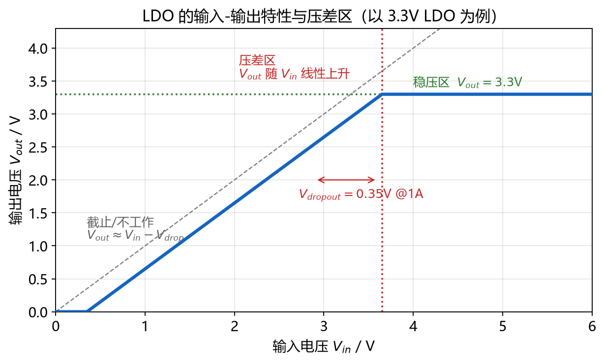

- **压差 $V_{dropout}$**：见 8.2.3，越小越好。
- **最大输出电流**：调整管能通过的最大电流。
- **静态电流 $I_q$**：输入电流与输出电流之差（$I_q=I_i-I_o$），由基准、采样电阻、误差放大器的偏置电流和调整管的驱动电流构成，它不产生输出功率，所以越小越好。SLVA079 指出：用双极型三极管做调整管时，$I_q$ 会随输出电流等比例增大；而用 MOS 管做调整管时，$I_q$ 几乎不随负载变化，所以在低功耗场合应当选 MOS 型 LDO。
- **PSRR（电源抑制比）**：衡量 LDO 对输入端纹波／噪声的抑制能力，数值越大越好。用在给 ADC、传感器、射频供电时尤其重要。
- **输出噪声**：LDO 自身产生的噪声，对噪声敏感的模拟电路要特别关注。
- **散热与结温**：LDO 把损耗全部变成热，设计时必须核算温度。调整管的功耗 $P=(V_{in}-V_o)I_o$，结温

  $$T_J=T_A+P\cdot\theta_{JA}$$

  其中 $T_A$ 是环境温度，$\theta_{JA}$ 是[热阻]（见第 2.3 节的 $T=t_0+P\theta$）。例如一颗 SOT-23 封装的 LDO，$\theta_{JA}$ 可能高达 $250\ \mathrm{^\circ C/W}$，让它承担 $0.5\ \mathrm{W}$ 的损耗，结温就会比环境高出 $125\ \mathrm{^\circ C}$ 以上，很容易过热保护甚至烧毁。**所以大压差、大电流的场合绝不能只靠 LDO，必须用 DC-DC。**

#### 8.2.5 何时用LDO，何时用DC-DC

- 选型时抓住一句话：**DC-DC 效率高但"脏"，LDO 干净但"费电"。**
- 需要大电流、电压差大 → 用 DC-DC（buck）。例如 12V 降到 5V、3A，用 buck 效率可以到 90% 以上，用 LDO 则会烧掉 21W。
- 需要极低噪声、给模拟电路／ADC／传感器供电 → 用 LDO。LDO 没有开关动作，不会产生开关纹波和电磁干扰，输出比 buck 干净得多。
- 最常用的组合是"**先 DC-DC 粗降，再 LDO 精稳**"：先用 buck 把 12V 高效降到 5V，再用一颗 LDO 把 5V 干净地降到 3.3V 给单片机／模拟部分供电。这样既有 DC-DC 的效率，又有 LDO 的低噪声，同时 LDO 上的压差和损耗也不大（5V 到 3.3V 只有 1.7V 压差，效率约 66%）。
- 这也是 8.3 节要讲的"供电系统结构"的核心思想。

### 8.3 项目供电系统的结构

#### 8.3.1 需求分析

- 设计供电系统的第一步不是画电路，而是**列需求**。需要弄清楚四件事：
  - **输入是什么**：是电池还是电源适配器？输入电压范围是多少？（例如 12V 适配器，实际可能波动到 10V～14V，甚至要按 5.5V～36V 这种宽范围设计。）
  - **需要哪些电压**：一般会有 5V（外设、舵机、传感器）和 3.3V（单片机、逻辑电路）等。
  - **每路需要多少电流**：要按最坏情况（所有负载同时全开）估算，并留足余量。
  - **哪些负载对噪声敏感**：模拟电路、ADC、传感器、射频属于敏感负载，需要干净的电源。
- 把这些写成一张表（电压／电流／噪声要求／效率要求），供电方案才有依据。

#### 8.3.2 供电树

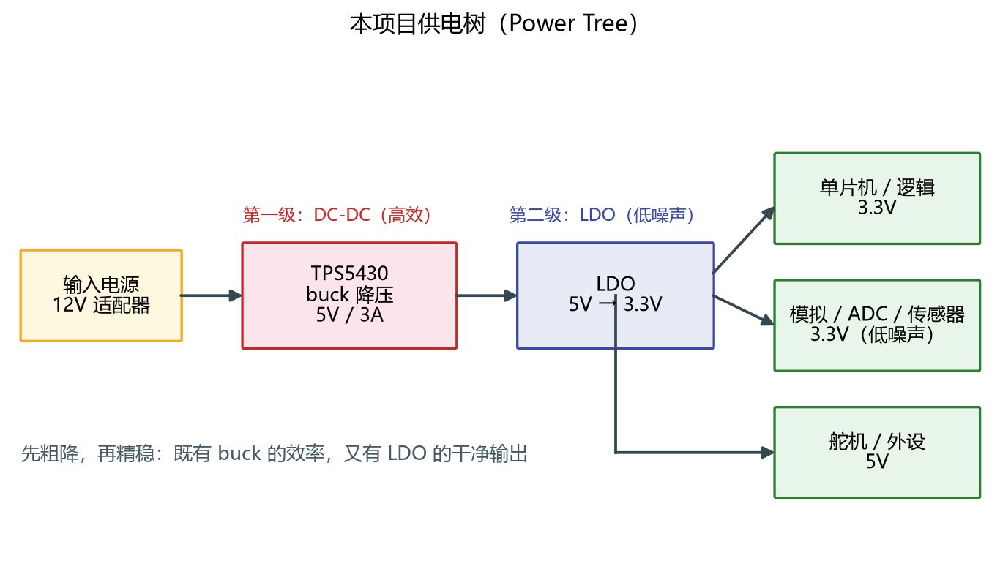

- [供电树]（Power Tree）就是把"输入 → 各级转换 → 各负载"画成一棵树，每个节点标注电压、电流、来源。它能一眼看出哪一级用的是 DC-DC、哪一级用的是 LDO，也能看出每级的损耗和发热点。
- 一份好的供电树要能回答：每路电压从哪来？经过了几级转换（级数越多效率越低）？哪一级电流最大？哪一级发热最严重？

#### 8.3.3 本项目的供电结构

- 本项目采用经典的"buck 粗降 + LDO 精稳"结构，如图 8-3-2-1：
  - **第一级：buck**。用 TPS5430 把输入电压（例如 12V）降到 5V。TPS5430 的输入范围是 5.5V～36V，输出能力 3A（峰值 4A），效率最高可达约 95%，非常适合做 12V／24V 母线到 5V 的这一级。
  - **第二级：LDO**。用一颗 LDO 把 5V 降到 3.3V 给单片机和模拟部分供电，压差只有 1.7V、效率约 66%，既安静又不至于太热。
  - **第三级：去耦**。每颗芯片的电源引脚旁边挂去耦电容（见第 4.3 节），大电容负责低频、小电容负责高频。
- 参考本仓库的开关电源工程 [JLCEDA开关电源工程文件](project/tps5430.epro2)，以及 [TPS5430/TPS5431 数据手册 （点击阅读）](datasheet/TPS5430数据手册_SLVS632L.pdf) 中的典型应用电路。

#### 8.3.4 保护电路

- 实际项目里，电源入口往往要加几道"保险"，防止上电瞬间或误操作把板子打坏。
- **防反接**：万一电源正负极接反，要有电路保证不烧。小电流可以用一个二极管串联（利用单向导电性，见第 3.1 节），但二极管有固定压降、大电流下损耗很大；更常见的做法是用一个 PMOS 管串在电源正极（利用 MOS 管导通电阻很小的特点，压降远小于二极管）。
- **过压／浪涌保护**：输入端并一个 [TVS] 管（见第 3.1.8 节），把浪涌电压钳位在安全范围内；必要时再并一个稳压管做二次钳位。
- **过流保护**：串一个保险丝或[自恢复保险丝]（PTC）。注意 TPS5430 本身自带逐周期限流和打嗝（hiccup）模式过流保护，芯片级的保护不能替代入口保险丝。
- **缓启动（Soft Start）**：上电瞬间输出电容是空的，会产生很大的浪涌电流。TPS5430 内置了软启动电路，典型软启动时间 8ms，让输出缓慢上升以限制浪涌电流。

#### 8.3.5 上电时序与使能

- 有些系统里，各路电源的"上电先后顺序"很重要（例如先给数字部分供电再给模拟部分，或反过来），否则可能发生[闩锁]或漏电。
- 控制上电顺序最常见的办法就是用芯片的[使能引脚 EN]。TPS5430 的 ENA 引脚行为如下：
  - 电压低于 $0.5\ \mathrm{V}$：芯片停止开关；
  - 电压高于 $1.3\ \mathrm{V}$：芯片开始开关；
  - 悬空（什么都不接）：芯片内部有一个 $1.5\ \mathrm{M\Omega}$ 的上拉电阻，默认使能，芯片正常工作；
  - 关断时芯片的静态电流可以降到约 $15\ \mu\mathrm{A}$。
- 所以如果不需要控制时序，ENA 直接悬空即可；如果要控制，可以用单片机的开漏输出（见第 5.1 节）去驱动它。**注意手册明确要求不要把 ENA 用电阻接地**。

#### 8.3.6 地的规划

- 供电系统里，"地"往往比"电源"更麻烦。功率电流（几安培、开关频率 500kHz 的脉冲）流过的地线，和单片机、传感器信号回流的"信号地"，如果混在一起，功率电流在地线上的压降就会变成信号上的噪声。
- 所以从规划供电系统的阶段就要把地分清楚：**功率地（PGND）**、**模拟地（AGND）**、**数字地（DGND）**，并确定它们在哪里汇合（[单点接地]）。具体怎么在 PCB 上落实，见 8.6.2～8.6.4 节。

### 8.4 buck电源的仿真

#### 8.4.1 仿真目标与工具

- 在画原理图和做 PCB 之前，先用仿真把设计验证一遍，能省下大量打板、焊接、调试的时间。
- 工具用 MATLAB／Simulink（安装与基本用法见第 6.1 节，具体建模方法见第 6.4 节）。本仓库第 6 章的两个模型 [MATLAB放大电路仿真](project/Ampfiler.slx)、[MATLAB火箭仿真](project/rocket.slx) 可以作为建模方式的参考。
- 仿真的目标有三个：验证 $V_o=D V_{in}$ 是否成立；看清电感电流、输出纹波等波形；验证我们选的电感、电容是否合适。

#### 8.4.2 搭建模型

- 一个最基本的 buck 仿真模型只需要四个部分：
  - **PWM 发生器**：用一个[锯齿波]（或三角波）信号和一个常数（代表控制电压）送进比较器，比较器输出就是占空比为 $D$ 的方波。改变那个常数就能改变 $D$。
  - **开关管**：用受控开关（Simulink 里的 Ideal Switch 或带控制的 MOS 模型）实现，控制信号接上一步的 PWM。
  - **功率级**：输入电容、开关管、续流二极管（或同步管）、电感、输出电容、负载，按图 8-1-3-1 连接。
  - **观测**：用示波器模块观测开关节点电压、电感电流、输出电压。

#### 8.4.3 观察波形

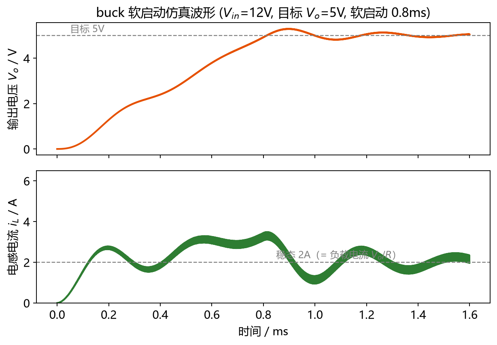

- 运行仿真后应该能看到：
  - **开关节点电压**：在 $V_{in}$ 和约 0V 之间跳变，导通时被拉到 $V_{in}$，关断时被二极管钳位到约 0V。
  - **电感电流**：围绕负载电流平均值上下波动的三角波，开关导通时上升、关断时下降。
  - **输出电压**：稳定在 $V_o$ 附近，叠加一个很小的纹波。
- 一开始输出电容充电时，输出电压会有一个上升过程，稳定之后就进入稳态（这也是真实电路里软启动要达到的效果）。
- 注意图 8-4-3-1 中，输出电压稳定以后，电感电流仍然有缓慢的振荡（LC 谐振）。这是因为这个"开环 + 恒定占空比"的模型里阻尼很小，真实的控制芯片内部有补偿网络专门把这个谐振压下去（见 8.4.6 与第 9.4 节），所以实测波形会比这个开环仿真平稳得多。

#### 8.4.4 验证公式

- 把仿真结果和 8.1 节的公式对照：
  - 改变 PWM 的占空比 $D$，看输出电压是否按 $V_o=D V_{in}$ 变化（例如 12V 输入、$D=41.7\%$，输出应该接近 5V）。
  - 把电感 $L$ 改小一半，看 $\Delta I_L$ 是否大约翻倍（$\Delta I_L\propto\frac{1}{L}$）。
  - 把开关频率 $f_{sw}$ 提高一倍，看纹波是否大约减半。
  - 把输出电容 $C$ 改大，看容性纹波是否减小。
- 如果仿真结果和公式对不上，先检查是不是进入了 DCM（见 8.1.8），或者是不是器件模型带了寄生参数。

#### 8.4.5 引入寄生参数

- 理想仿真里电感和电容都没有电阻，纹波会非常小。把**电感的串联电阻 ESR** 和**电容的 ESR** 加进去（见第 2.2 节），就能看到和真实电路接近的纹波与损耗。
- 特别地，把输出电容的 ESR 从 0 改到几十毫欧，会看到输出纹波明显变大，这正好印证了 8.1.3 节"输出纹波主要由 ESR 决定"的结论。

#### 8.4.6 加入闭环反馈

- 前面的模型都是开环的（占空比固定）。在开环模型上加一个负反馈：把输出电压与目标值相减，误差经过一个 PI（或 PID）控制器，输出作为 PWM 的比较阈值，就构成了闭环。
- 闭环之后，即使把输入电压从 12V 改到 15V，或者把负载电流突变一下，输出电压也会自动稳定在目标值附近。闭环的动态响应（超调、恢复时间、稳定性）与第 6 章的 PID、以及第 9.4 节的补偿网络直接相关。

### 8.5 原理图绘制

#### 8.5.1 细读DCDC控制芯片的数据手册

- 画原理图之前，**必须先精读控制芯片的数据手册**，这是整个 8.5 节最重要的一步。以 TPS5430 为例，要重点看以下几部分：
  - **引脚功能（Pin Functions）**：BOOT（1 脚，自举电容）、VSENSE（4 脚，反馈）、ENA（5 脚，使能）、GND（6 脚，接散热焊盘 DAP）、VIN（7 脚，输入）、PH（8 脚，开关节点）。
  - **极限参数（Absolute Maximum Ratings）**：任何时候都不能超过，否则芯片永久损坏。
  - **推荐工作条件（Recommended Operating Conditions）**：输入电压范围（TPS5430 为 5.5V～36V）。
  - **电气特性（Electrical Characteristics）**：基准电压（1.221V）、上管导通电阻（典型 100mΩ）、最小导通时间（典型 200ns）等。
  - **典型应用电路（Typical Application）**：芯片厂商已经帮你设计好的参考电路，是最重要的参考。
  - **元件计算**：反馈电阻、电感、输出电容、自举电容、续流二极管的取值（见 8.5.2）。

#### 8.5.2 buck原理图绘制

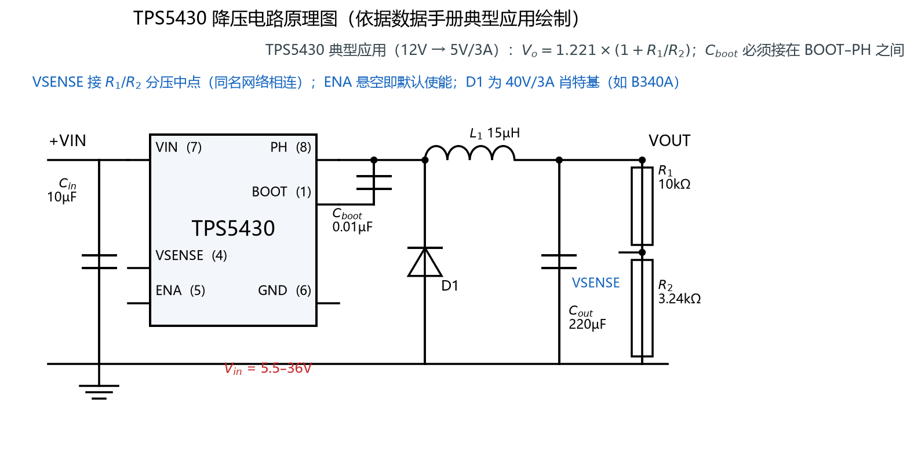

- 按 TPS5430 数据手册的典型应用（5V／3A 输出），buck 的原理图包含以下元件，每一个都有明确的计算依据：
  - **输入电容 $C_{in}$**：数据手册要求把一个低 ESR 的陶瓷旁路电容接在 VIN 和 GND 之间，并且**要放在距芯片引脚 1mm 以内**（第 4 节引脚说明）。除此之外还要在电源入口放一个大容量的[体电容]（bulk capacitor）。注意输入电容要承受输入纹波电流（手册示例中有效值约 1.5A），耐压要按最大输入电压加半个纹波电压来选。
  - **自举电容 $C_{boot}$**：接在 BOOT 和 PH 之间，必须是 $0.01\ \mu\mathrm{F}$ 的低 ESR 陶瓷电容。它的作用是为芯片内部的上管栅极驱动提供自举电源（芯片同时集成了自举二极管，所以外部只要一个电容）。
  - **电感 L**：按 8.1.7 的公式选取。手册示例：$K_{IND}=0.2$、最小电感 $12.5\ \mu\mathrm{H}$、实际选 $15\ \mu\mathrm{H}$（$I_{sat}=3.4\ \mathrm{A}$、$I_{rms}=3.6\ \mathrm{A}$）。再次强调必须核对**峰值电流小于 $I_{sat}$、有效值小于 $I_{rms}$**。
  - **输出电容 $C_{out}$**：手册示例选 $220\ \mu\mathrm{F}$、最大 ESR 40mΩ，可再并联一个 0.1µF 陶瓷小电容改善高频特性。选型时核对耐压、纹波电流能力和 ESR。
  - **续流二极管 D**：手册要求反向耐压要高于开关节点最大电压（$V_{in(max)}+0.5\ \mathrm{V}$），峰值电流要大于 $I_{o(max)}$ 加半个电感纹波电流，并且正向压降 $V_f$ 要小以提高效率。手册示例选用 B340A（40V／3A／$V_f=0.5\ \mathrm{V}$）。
  - **反馈分压电阻 R1、R2**：由 $V_o=1.221\times\left(1+\frac{R_1}{R_2}\right)$ 决定；5V 输出时取 $R_1=10\ \mathrm{k\Omega}$、$R_2=3.24\ \mathrm{k\Omega}$。
  - **使能 ENA**：不需要控制时直接悬空（内部上拉），需要控制时接单片机开漏输出。
- 画图时还要注意：网络命名要规范（$V_{in}$、$+5V$、$GND$、$SW$ 等）；地网络要统一；跨页连接要用[网络标签]而不是满图飞线（见第 1.1 节的[网络]概念）；芯片的 GND 必须和散热焊盘 DAP 一起接到地。

#### 8.5.3 LDO原理图绘制

- LDO 的原理图比 buck 简单得多，主要关注四点：
  - **输入电容和输出电容**：按 LDO 数据手册要求的容值和 ESR 选取，输出电容通常有"稳定范围"要求（详见 LDO 手册），不可随意省略或更换类型。
  - **使能引脚**：LDO 一般也有 EN，处理方式与 buck 的 ENA 类似。
  - **反馈引脚**：固定输出的 LDO 内部已经接好分压电阻，不需要外接；可调输出的才需要外接分压电阻，公式与 buck 相同。
  - **散热**：LDO 的损耗全部变成热，原理图上要确保它的散热焊盘／铜皮有足够面积。必要时在原理图里就把它的功耗算出来（$P=(V_{in}-V_o)I_o$），确认不超过封装允许值。

#### 8.5.4 单片机原理图绘制

- 单片机的原理图在第 5 章已经详细讲过，这里只做回顾式提示。以 STM32F103C8T6 为例，最小系统包括：
  - **电源与去耦**：每个 VDD 引脚旁边都要放 100nF 的去耦电容，另外在电源入口放一个 1µF～10µF 的电容（见第 4.3 节）。
  - **晶振**：外部高速晶振（HSE）与负载电容，尽量靠近芯片。
  - **复位电路**：NRST 引脚的复位电容与上拉电阻。
  - **启动配置**：BOOT0、BOOT1 引脚的下拉电阻。
  - **下载调试口**：SWD（SWDIO、SWCLK）。
  - **指示灯与外设接口**：LED、按键、通信接口等。
- 参考本仓库的 [STM32F103C8T6 数据手册](datasheet/STM32F103C8T6数据手册.pdf) 与 [参考手册](datasheet/STM32F103C8T6参考手册.pdf)。

#### 8.5.5 原理图检查

- 画完原理图后，一定要做[ERC]（电气规则检查），并在软件里逐项确认：有没有悬空的引脚、有没有重复的网络名、电源网络的连接是否正确、地是否都连上了。
- 建议把重复使用的电路（例如"3.3V 去耦"、"buck 功率级"）做成[图块]或[层次化子图]，方便复用和检查。
- 原理图确认无误后，再同步到 PCB。

### 8.6 PCB绘制

#### 8.6.1 布局总原则

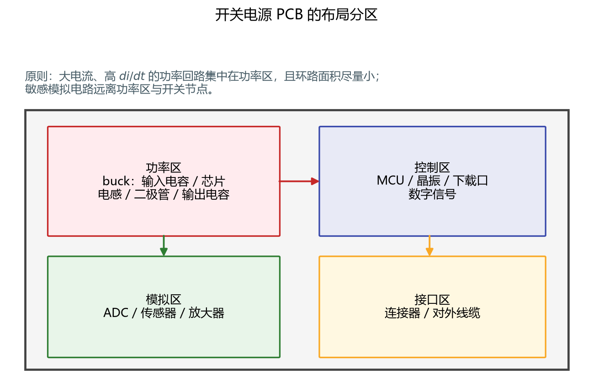

- 布局先于布线。开关电源布局的核心原则是：**先按电流走向摆放，把大电流、高 $di/dt$ 的路径尽量缩短**。
- TPS5430 数据手册的布局指南给出了几条非常具体的建议：
  - 把输入旁路电容（低 ESR 陶瓷）尽可能靠近 VIN 引脚和 GND 引脚，**距离芯片引脚 1mm 以内**，并**尽量减小这个电容构成的环路面积**。
  - PH 引脚到输出电感、续流二极管、自举电容的走线要短而粗。
  - 自举电容要尽量靠近芯片，走线尽量短。
  - 输出滤波电容要按图接在 VOUT 和 GND 之间，同样要**减小环路面积**。
  - VOUT 到 VSENSE 的反馈分压网络要**远离噪声源**，不要和开关节点、大电流走线并行。

#### 8.6.2 功率回流路径与单点接地

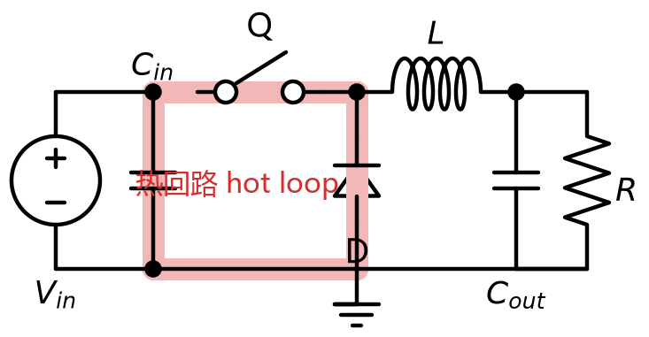

- 8.1.3 节提到 buck 的输入电流是脉冲的。这个脉冲电流只在"输入电容 → 开关管 → 电感 → 负载 → 地 → 输入电容"这个环路里流动，我们把它叫做[功率回路]或[热回路]（hot loop）。
- **这个环路的面积越小越好**。原因在于：脉冲电流的 $di/dt$ 极大，环路面积越大，环路等效的电感与"天线效应"就越强，会产生：
  - 开关节点上的[电压尖峰]（$u=L\frac{di}{dt}$），可能超过器件耐压；
  - 强烈的[电磁干扰]（EMI），干扰附近的信号线和外部设备。
- TI 的应用报告 SZZA009 在"Basic Loops"一节明确指出：**环路面积与辐射强度成正比，减小环路面积是降低 EMI 最有效的手段**。
- 实现方法：把输入电容紧贴芯片的 VIN 与 GND 引脚；用铺铜（而不是细走线）承载大电流并让电流沿最短路径返回；把"输入电容—芯片—电感—输出电容"的地用一小块**连续的铜皮**连在一起，而不是让电流绕远路回到电源入口的地。
- **[单点接地]**：功率地和信号地各自成一片，最后只在**一个点**（通常是芯片的 GND／DAP 焊盘）汇合。这样功率电流不会流经信号回流的路径，也就不会污染信号。

#### 8.6.3 信号回流路径与参考平面

- 每一根信号线上的电流，都要经由"地"回到源头，这条路叫做[回流路径]。高频信号的回流电流总是走**最靠近信号线的那条路径**（因为那样环路面积最小、电感最小）。
- 因此，信号线**正下方应该有一块完整、连续的参考平面**（通常是地平面）。如果信号线下方正好有一道地平面的"裂缝"或者被挖空，高频回流就必须绕远路，环路面积骤增，产生辐射和信号完整性问题。
- 推论：**不要让关键信号跨越地平面的分割缝**；能不分割地平面就不分割。

#### 8.6.4 地平面分割

- 很多教程会说"要把模拟地和数字地分开"。这件事本身是对的，但**关键在于"分开后在哪里汇合"**：如果分割了地平面却没有给回流电流留一条合理的汇合路径，反而会制造更严重的问题（跨分割）。
- 实用建议：
  - 功率部分（buck 的输入电容、芯片、电感、输出电容）单独占一块**功率地**，走大电流、铺大铜皮。
  - 单片机、模拟电路用**信号地**（模拟地和数字地可以合成一块"干净地"）。
  - 两者只在**一个点**（通常是芯片 GND／DAP 下方或电源入口处）用铜皮或 0Ω 电阻汇合。
  - 对两层板来说，"不分割地平面、而是把功率回路和信号区域在物理上分开摆放"，往往比"把地平面上割一刀"更稳妥。

#### 8.6.5 去耦电容

- 去耦电容的作用与摆法在第 4.3 节已经详细讲过，这里补充 PCB 层面的要求：
  - 去耦电容要**尽量贴近芯片的电源引脚**，距离越远效果越差。
  - **容值越小的电容越要靠引脚**（100nF 紧贴引脚，1µF／10µF 可以稍远）。
  - 电容到引脚、电容到地的走线要短而粗，尽量用**过孔直接打到地平面上**，不要在电容和引脚之间走长长的细线。
  - 每个电源引脚都要有自己的一颗去耦电容，不要"共用"。

#### 8.6.6 过孔阵列

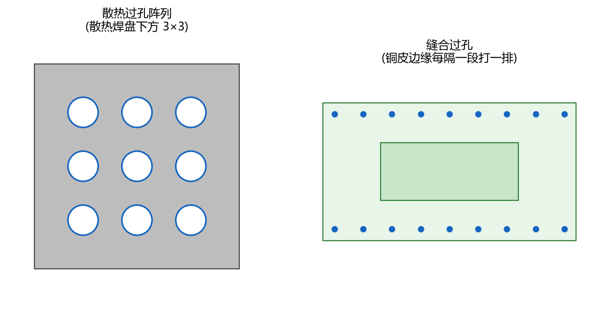

- 过孔在开关电源 PCB 里有两个重要用途：
  - **散热过孔（thermal via）**：TPS5430 是带散热焊盘（DAP）的封装，芯片的热量靠焊盘传导到 PCB。在 DAP 下方打一排（通常是 3×3 或更多）**散热过孔**连接到下方的大铜皮或地平面，可以大幅降低热阻、帮助散热。
  - **缝合过孔（stitching via）**：在功率地、信号地等不同区域的铜皮边缘，每隔一段距离打一排过孔，把上下层的地"缝"在一起，减小地阻抗和回流环路面积。
- 大电流路径上也可以用**多个过孔并联**来降低等效电阻和电感（一个过孔的载流能力和阻抗是有限的）。
- 注意：过孔会占面积，散热焊盘下的过孔如果开孔不当可能导致[漏锡]，实际加工时需要用[塞孔]或[盖油]处理（见 8.6.12）。

#### 8.6.7 阻焊开窗

- [阻焊开窗]（也叫开窗、开锡）是指在大电流走线或散热区域上，故意把[阻焊层]（绿油）去掉，露出铜皮，这样在焊接（尤其是过波峰焊或手工加锡）时可以在这里堆上更多焊锡。
- 锡的电阻率远低于铜的电阻率，加锡相当于给走线并联了一条"低阻通路"，既能**提高载流能力**、又能**帮助散热**，还能**降低走线电阻**带来的损耗。
- 常见的开窗位置：大电流的电源走线、buck 的功率回路、电感／二极管／MOS 管的散热焊盘、以及需要过大电流的引脚附近。

#### 8.6.8 高频信号EMI

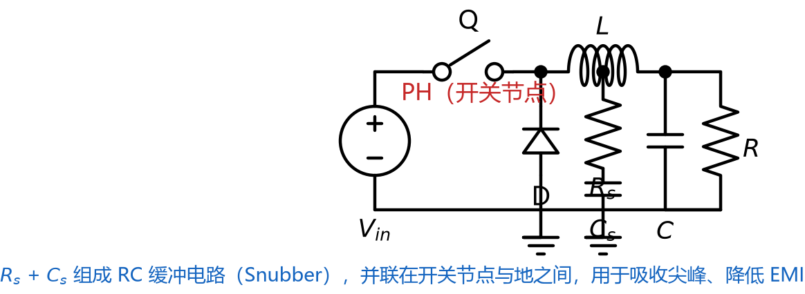

- 开关电源最大的 EMI 来源就是[开关节点]（PH／SW）。它的电压以 $500\ \mathrm{kHz}$ 的频率在 $V_{in}$ 和 0V 之间反复跳变，$\frac{du}{dt}$ 极高，既会通过电场耦合，又会通过[功率回路]辐射。
- 降低 EMI 的常用手段：
  - **缩小开关节点铜皮面积**（图 8-6-8-1）：节点铜皮面积越大，寄生电容越大，耦合越强。可以把开关节点做小一些，同时加大它与其它网络的距离。
  - **减小功率回路面积**（见 8.6.2）。
  - **加缓冲电路（[Snubber]）**：在开关节点对地接一个 RC 吸收电路，把尖峰能量耗散掉，能明显改善 EMI，代价是一点额外的损耗。
  - **降低开关速度**：如果 EMI 严重，可以适当增大栅极驱动电阻来减慢开关速度（代价是开关损耗增加）。
  - **用屏蔽电感**：带磁屏蔽的电感漏磁更小。
- TI 的 SZZA009 还系统地给出了几个通用措施：**信号线尽量短**、**避免形成大环路**、**高频信号远离接口和线缆**、**按功能对板子进行[分区]（board zoning）**，让噪声源和敏感电路在物理上分开。

#### 8.6.9 阻抗匹配

- [阻抗匹配]是指让信号线的[特征阻抗]与源端／负载端的阻抗相匹配，避免信号在阻抗不连续处反射。
- 对开关电源本身来说，功率走线是"直流 + 低频"，一般不需要做阻抗匹配；真正需要的是**高速信号**（时钟、SPI、USB、以及较长的信号线）。是否需要匹配由信号的上升时间和走线长度共同决定。
- 常用的匹配方式有[串联端接]电阻、[并联端接]和[戴维南端接]等。在我们这类项目中，一般只需要：**高速信号线尽量短、尽量走直线、下面有完整参考平面、必要时串联一个端接电阻**。

#### 8.6.10 导出Gerber与BOM表

- 画完 PCB 后，需要导出两样东西交给板厂和采购：
  - **Gerber 文件**（光绘文件）：描述 PCB 的每一层（铜箔、阻焊、丝印、钻孔、板框等），是板厂生产电路板的依据。
  - **BOM 表**（Bill of Materials，物料清单）：列出所有元件的位号、名称、封装、数量，是采购和焊接的依据。
- 嘉立创 EDA 支持一键导出 Gerber 和 BOM，导出前务必确认：层设置正确（顶层／底层／阻焊／丝印／钻孔／板框齐全）、最小线宽和最小间距符合板厂工艺能力、板框尺寸正确。

#### 8.6.11 整理BOM表与采购元件

- 导出的 BOM 通常需要人工整理：把供应商型号、封装、数量、单价填齐，并和原理图逐个核对位号。
- **如何省钱地购买元件**：
  - 优先选**常用封装**、**常用阻容值**，批量采购单价更低。
  - 在不影响功能的前提下选**更便宜的替代型号**，但要先核对关键参数（耐压、电流、精度、温度系数）是否满足要求。
  - 在立创商城（可在 [实用网站.md](实用网站.md) 找到链接）上可以直接查元件价格、库存和规格书，还可以直接下单打板。
  - 打样阶段按实际数量买，不要囤太多；但常用阻容可以一次多买些。

#### 8.6.12 PCB下单注意事项

- 在嘉立创（或其它板厂）下单前，要核对以下参数：
  - **板子层数**：本项目用两层板即可。
  - **板厚**：常用 1.6mm。
  - **铜厚**：默认 1oz（约 35µm）。大电流场合可以选 2oz 以降低走线电阻、提高载流能力。
  - **阻焊颜色／丝印颜色**：按需选择。
  - **表面处理**：常用[喷锡]（HASL，便宜、可焊性好）或[沉金]（ENIG，平整度好，适合细间距元件）。
  - **过孔工艺**：散热焊盘下的过孔建议[盖油]或[塞孔]，防止漏锡。
  - **拼板与阻抗**：如果需要拼板或特殊阻抗控制，要提前说明。
  - **交付时间**：加急要额外收费，留足打样往返的时间。
- 下单前**一定要用软件自带的 DRC（设计规则检查）跑一遍**，确认没有违反板厂工艺能力的地方。

